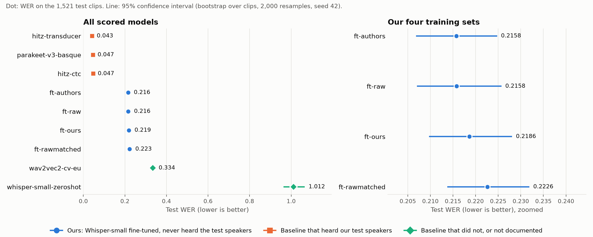

# Basque Parliamentary Speech Recognition (Project 3)

Speech recognition for Basque (`eu`) speeches in the Basque Parliament. The project has two parts:

1. **Baselines:** eight pretrained models that support Basque, scored on the same 1,521 test
   clips, with no training by us.
2. **Our contribution:** does cleaning the training transcripts help a fine-tuned Whisper-small,
   and can our own cleaning match the corpus authors' clean split? Four training sets, three
   seeds each, compared with paired bootstrap tests.

Main metric: normalised **WER**, with **CER** next to it (why: [Metrics](#metrics)). All
numbers in this README are written by `src/score_all.py`; nobody types them in.

## Contents

- [Data](#data) · [Splits: no speaker leak](#splits-no-speaker-leak) · [Cleaning](#cleaning)
- [Baselines](#baselines) · [Baselines not run](#baselines-not-run)
- [Metrics](#metrics) · [Results](#results) · [Speed](#speed)
- [How to reproduce](#how-to-reproduce) · [Seeds and hardware](#seeds-and-hardware)
- [Repository layout](#repository-layout) · [Team](#team) · [Licence](#licence)

## Data

[Basque Parliament Speech Corpus 1.0](https://huggingface.co/datasets/gttsehu/basque_parliament_1)
(`gttsehu/basque_parliament_1`, Basque part, CC0 1.0). Its `train` clips were cut and aligned
automatically; its `dev` and `test` clips were checked by hand. Full details: [`data/README.md`](data/README.md).

- **Raw sample:** 20.00 h (10,515 clips, 146 speakers, 2013–2021), drawn at random (seed 42)
  from all Basque clips of the official `train` split by `src/make_sample.py`.
- **Dev:** every Basque clip of the official `dev` split (1,397 clips, 2.58 h). Used for every
  decision: cleaning thresholds, training settings, checkpoints, the scoring policy.
- **Test:** every Basque clip of the official `test` split (1,521 clips, 2.81 h). Used once per
  model, for the final score.

The audio (MP3, unchanged from the corpus, 281 MB) and all manifests are in the repository.

### Splits: no speaker leak

**None of our training sets shares a speaker with `dev` or `test`.** The official `train` split
is not speaker-separate from `dev` and `test`, so `src/clean.py` (rule 1) removes from every
training set each clip whose speaker speaks in `dev` or `test`, each clip with `speaker_id` 0
(unknown speaker, so it cannot be checked), and each clip whose sentence or audio is in `dev` or
`test`. Numbers from [`data/split_report.md`](data/split_report.md), written by `src/split_report.py`:

| Split | Clips | Hours | Speakers | Speakers shared with dev | with test | Test sentences in the set |
|---|---|---|---|---|---|---|
| Raw sample (before rule 1) | 10,515 | 20.00 | 146 | 32 | 25 | 5 |
| `train_raw` | 4,844 | 9.24 | 107 | 0 | 0 | 0 |
| `train_ours` | 4,264 | 8.23 | 102 | 0 | 0 | 0 |
| `train_authors` | 4,143 | 8.23 | 103 | 0 | 0 | 0 |
| `train_rawmatched` | 4,311 | 8.23 | 107 | 0 | 0 | 0 |
| `dev` | 1,397 | 2.58 | 32 | | | |
| `test` | 1,521 | 2.81 | 25 | | | |

- The speaker rule removed 5,241 clips (9.86 h) by speakers of `dev`/`test` and 426 clips
  (0.89 h) without a speaker. That is why training uses at most 9.24 of the 20 sampled hours.
- The official `dev` and `test` come from different sessions (February 2022) but share 18
  speakers. This is harmless: `dev` is never trained on.
- 46 `test` clips have no speaker id; they cannot be checked against any split.

### Cleaning

`src/clean.py` only removes training clips; it never rewrites a transcript and never touches
`dev` or `test`. Nobody in the group speaks Basque, so every decision is a rule with a threshold
chosen on `dev`. Rules 2–6 are our cleaning: broken text, speaking rate and duration, repeated
sentences or overlapping audio, a Whisper large-v3 judge (CER between its transcript and ours),
and wrong language. They remove 378 of the 4,844 clips (0.62 h, 7.8%). The judge threshold was
calibrated by breaking `dev` transcripts on purpose: it catches 96.3% of them and removes 4.7% of
untouched ones. Details, and the comparison with the authors' filter (Cohen's kappa 0.18):
[`data/cleaned/cleaning_report.md`](data/cleaned/cleaning_report.md) and [`data/README.md`](data/README.md).

The four fine-tuning conditions:

| Run | Training set | What it tests |
|---|---|---|
| `ft-raw` | `train_raw.csv`: raw sample after the speaker rule only (9.24 h) | More but noisier hours |
| `ft-rawmatched` | `train_rawmatched.csv`: random 8.23 h of `train_raw` | Control: less data, no cleaning |
| `ft-authors` | `train_authors.csv`: clips of `train_raw` in the authors' `train_clean`, cut to 8.23 h | The authors' cleaning |
| `ft-ours` | `train_ours.csv`: clips kept by our rules 2–6, cut to 8.23 h | Our cleaning |

The three cleaned or matched sets have the same hours, so a difference between them comes from
which clips they hold, not from how much audio they hold.

## Baselines

Eight pretrained models that list Basque on their model card, run on the same test clips with
no training by us:

| Run | Model | Type |
|---|---|---|
| `whisper-large-v3` | [openai/whisper-large-v3](https://huggingface.co/openai/whisper-large-v3) | Whisper, multilingual |
| `whisper-small-zeroshot` | [openai/whisper-small](https://huggingface.co/openai/whisper-small) | Whisper, the model we fine-tune, before fine-tuning |
| `hitz-ctc` | [HiTZ/stt_eu_conformer_ctc_large](https://huggingface.co/HiTZ/stt_eu_conformer_ctc_large) | NeMo Conformer-CTC, Basque |
| `hitz-transducer` | [HiTZ/stt_eu_conformer_transducer_large](https://huggingface.co/HiTZ/stt_eu_conformer_transducer_large) | NeMo Conformer-Transducer, Basque |
| `parakeet-v3-basque` | [itzune/parakeet-tdt-0.6b-v3-basque](https://huggingface.co/itzune/parakeet-tdt-0.6b-v3-basque) | Parakeet TDT v3, fine-tuned for Basque by a third party |
| `wav2vec2-bp1` | [gttsehu/wav2vec2-xls-r-300m-bp1-es_eu](https://huggingface.co/gttsehu/wav2vec2-xls-r-300m-bp1-es_eu) | wav2vec 2.0 XLS-R, trained on this corpus |
| `wav2vec2-cv-eu` | [stefan-it/wav2vec2-large-xlsr-53-basque](https://huggingface.co/stefan-it/wav2vec2-large-xlsr-53-basque) | wav2vec 2.0 XLSR-53, trained on Common Voice |
| `mhubert-basque` | [Ansu/mHubert-basque-ASR](https://huggingface.co/Ansu/mHubert-basque-ASR) | mHuBERT-147 + CTC, Basque |

**Which baselines heard our test speakers.** Five of them were trained on this corpus
(`hitz-ctc`, `hitz-transducer`, `parakeet-v3-basque`, `wav2vec2-bp1`, `mhubert-basque`), and the
corpus's training split contains the speakers of its test split. They have heard our test
speakers; our fine-tuned models have not. The comparison is therefore in their favour. The
results table marks this in its own column, read from Tuğra's audit,
[`report/baseline_audit.md`](report/baseline_audit.md).

`wav2vec2-cv-eu` was added on 18 November after a quick check that it runs on our data, not
chosen for a good score. It is the only wav2vec 2.0 model that never heard our test speakers.

### Baselines not run

A baseline is run only if its model card lists Basque. A model without Basque is never run with
another language setting.

| Model | Why not run |
|---|---|
| [nvidia/canary-1b-v2](https://huggingface.co/nvidia/canary-1b-v2) | 25 European languages, not Basque |
| [nvidia/parakeet-tdt-0.6b-v3](https://huggingface.co/nvidia/parakeet-tdt-0.6b-v3) | 25 European languages, not Basque; its Basque fine-tune `parakeet-v3-basque` is run instead |
| [Qwen/Qwen3-ASR-1.7B](https://huggingface.co/Qwen/Qwen3-ASR-1.7B) | 30 languages and 22 Chinese dialects; Basque is not among them |
| MFCC + GMM-HMM | Optional per the teacher. There is no pretrained Basque model, and training one did not fit the week |

## Metrics

Full reasoning: [`report/metric_justification.md`](report/metric_justification.md). Exact
rules: [`report/scoring_policy.md`](report/scoring_policy.md) (frozen on 18 November, before
any test score).

- **Main metric: normalised WER** = (substitutions + deletions + insertions) / reference words,
  at corpus level. It is the standard metric, and the one every baseline's model card reports.
- **CER** for every run: Basque adds endings to words, so one wrong ending makes the whole word
  wrong in WER, while CER counts only the wrong letters.
- **Normalised only.** The references have no capitals, no punctuation and no digits (we
  checked all 1,397 `dev` references), so orthographic WER cannot be measured. Normalisation:
  Unicode NFC, lowercase, punctuation becomes a space, spaces collapsed. Numbers are not
  rewritten, so a model that writes `2022` where the reference says `bi mila hogeita bi` is
  counted wrong on that number. Whisper can write digits; the error analysis counts number
  errors separately.
- **WER has no upper bound.** Zero-shot Whisper-small often repeats a phrase until it reaches
  its 128-token limit, and its WER is above 1. We report these loops instead of hiding them with
  decoding tricks.
- Checkpoints are chosen with `clean.normalise` on `dev`; final scores use `src/normalize.py` on
  `test`. The two functions give the same text, which `tests/test_normalize.py` checks.
- **Statistics:** 95% confidence intervals by bootstrap over clips (2,000 resamples, seed 42).
  Fine-tuning conditions: mean and SD over 3 seeds. The five comparisons below were fixed
  before any test score existed; each gives the difference, its 95% interval and a two-sided
  p-value from a paired bootstrap on the same clips.

## Results

Test split, 1,521 clips. Lower is better. Written by `python src/score_all.py`, which also writes
`results/results_table.csv`/`.md` and `results/paired_comparisons.csv`.

<!-- results:start (written by src/score_all.py, do not edit by hand) -->
Written by `src/score_all.py`. Do not edit by hand.

Scoring policy: `report/scoring_policy.md`. WER and CER are corpus-level, after `src/normalize.py`. 95% intervals: bootstrap over clips, 2,000 resamples, seed 42.

### Baselines (pretrained models, no training by us)

Heard our test speakers: from `report/baseline_audit.md`. A model that heard them was trained on this corpus, so the comparison is in its favour.

| Run | Model | Heard our test speakers? | WER | WER 95% CI | CER | CER 95% CI |
|---|---|---|---|---|---|---|
| `whisper-large-v3` | `openai/whisper-large-v3` | Unknown | not scored yet | | | |
| `whisper-small-zeroshot` | `openai/whisper-small` | Unknown | 1.0117 | [0.9636, 1.0656] | 0.4016 | [0.3718, 0.4345] |
| `hitz-ctc` | `HiTZ/stt_eu_conformer_ctc_large` | Yes | 0.0475 | [0.0436, 0.0513] | 0.0151 | [0.0137, 0.0166] |
| `hitz-transducer` | `HiTZ/stt_eu_conformer_transducer_large` | Yes | 0.0428 | [0.0392, 0.0464] | 0.0151 | [0.0137, 0.0167] |
| `parakeet-v3-basque` | `itzune/parakeet-tdt-0.6b-v3-basque` | Yes | 0.0468 | [0.0432, 0.0504] | 0.0157 | [0.0142, 0.0173] |
| `wav2vec2-bp1` | `gttsehu/wav2vec2-xls-r-300m-bp1-es_eu` | Yes | not scored yet | | | |
| `wav2vec2-cv-eu` | `stefan-it/wav2vec2-large-xlsr-53-basque` | No | 0.3338 | [0.3232, 0.3443] | 0.0699 | [0.0670, 0.0730] |
| `mhubert-basque` | `Ansu/mHubert-basque-ASR` | Yes | not scored yet | | | |

### Our contribution (Whisper-small fine-tuned)

Mean over seeds ± SD over seeds. The interval is the bootstrap over clips of the per-clip mean over seeds. None of our training sets contains a `dev` or `test` speaker.

| Run | Training set | Seeds | WER | WER 95% CI | CER | CER 95% CI | WER per seed |
|---|---|---|---|---|---|---|---|
| `ft-raw` | train_raw.csv: raw sample, leakage rule only (9.24 h) | 3 | 0.2158 | [0.2070, 0.2257] | 0.0565 | [0.0526, 0.0614] | 0.2158 |
| `ft-rawmatched` | train_rawmatched.csv: random part of the raw sample, same hours as the cleaned sets | 3 | 0.2226 | [0.2137, 0.2319] | 0.0554 | [0.0527, 0.0582] | 0.2226 |
| `ft-authors` | train_authors.csv: the corpus authors' clean split | 3 | 0.2158 | [0.2068, 0.2248] | 0.0520 | [0.0495, 0.0547] | 0.2158 |
| `ft-ours` | train_ours.csv: our cleaning script | 3 | 0.2186 | [0.2097, 0.2281] | 0.0542 | [0.0516, 0.0569] | 0.2186 |

### Paired comparisons (fixed before any test score)

Difference = A − B; negative means A makes fewer errors. Paired bootstrap on the same clips; two-sided p-value.

| A | B | Question | WER diff | 95% CI | p | CER diff | 95% CI | p |
|---|---|---|---|---|---|---|---|---|
| `ft-ours` | `ft-rawmatched` | Does cleaning help beyond having less data? | -0.0040 | [-0.0089, +0.0010] | 0.116 | -0.0012 | [-0.0028, +0.0002] | 0.098 |
| `ft-ours` | `ft-authors` | Does our cleaning match the authors' cleaning? | +0.0028 | [-0.0019, +0.0078] | 0.257 | +0.0021 | [+0.0007, +0.0036] | 0.002 |
| `ft-authors` | `ft-rawmatched` | Does the authors' cleaning help beyond having less data? | -0.0068 | [-0.0124, -0.0015] | 0.010 | -0.0034 | [-0.0051, -0.0018] | < 0.001 |
| `ft-raw` | `ft-rawmatched` | Do more but noisier hours win? | -0.0068 | [-0.0120, -0.0013] | 0.019 | +0.0011 | [-0.0017, +0.0051] | 0.658 |
| `ft-authors` | `whisper-small-zeroshot` | How much does fine-tuning help? (A chosen by mean dev WER) | -0.7960 | [-0.8491, -0.7470] | < 0.001 | -0.3496 | [-0.3822, -0.3202] | < 0.001 |
<!-- results:end -->



Dot: test WER. Line: 95% confidence interval. Right panel: our four training sets, zoomed in.
Drawn by `python src/plot_results.py` from `results/results_table.csv`.

Error types (substitutions, deletions, insertions, number errors, repetition loops) per model:
[`report/error_analysis.md`](report/error_analysis.md).

## Speed

RTFx = audio seconds / compute seconds (higher is faster), measured the same way for every model
by `src/timing.py`: from audio in memory to text returned, model loading excluded, 5 warm-up
clips, batch size 1, Colab T4, 100 `dev` clips per model. Table: `results/runtime_table.md`.

## How to reproduce

Python 3.12. Run everything from the repository root.

```bash
pip install -r requirements.txt            # scoring, cleaning, Whisper and wav2vec 2.0
pytest                                     # tests for the data, the cleaning and the scoring

# 1. Data (already in the repo; this rebuilds it from the corpus)
python src/make_sample.py                  # 20 h raw sample + dev + test, seed 42
python src/clean.py --judge dev            # Whisper large-v3 judge on dev (GPU)
python src/clean.py --judge train          # the same on the raw sample (GPU)
python src/clean.py                        # apply the rules, write data/cleaned/ (no GPU)
python src/split_report.py                 # data/split_report.md

# 2. Fine-tuning: 4 conditions x seeds 1, 2, 3 (GPU), then transcribe with the best checkpoint
python src/finetune_whisper.py --condition ours --seed 1          # also raw, authors, rawmatched
python src/transcribe.py --family whisper --model models/ft-ours_seed1/best --name ft-ours_seed1 --split test

# 3. Baselines (Hugging Face models)
python src/transcribe.py --family whisper --model openai/whisper-small --name whisper-small-zeroshot --split test
python src/transcribe.py --family whisper --model openai/whisper-large-v3 --name whisper-large-v3 --split test
python src/transcribe.py --family ctc --model gttsehu/wav2vec2-xls-r-300m-bp1-es_eu --name wav2vec2-bp1 --split test
python src/transcribe.py --family ctc --model stefan-it/wav2vec2-large-xlsr-53-basque --name wav2vec2-cv-eu --split test
python src/transcribe.py --family ctc --model Ansu/mHubert-basque-ASR --name mhubert-basque --split test

# 4. Baselines (NeMo models), in a separate environment
pip install -r requirements-nemo.txt
python src/run_nemo.py --run hitz-ctc --split test --manifest data/raw/manifests/test.csv
#   also --run hitz-transducer and --run parakeet-v3-basque

# 5. Scores
python src/score_all.py                    # results tables, paired comparisons, this README's Results
python src/plot_results.py                 # results/figures/wer_ci.png
python src/score_all.py --split dev        # the same on dev, for quick checks
```

Every prediction file keeps the model's raw output (`results/predictions/<run>_<split>.csv`),
with its settings, model revision and hardware next to it (`<run>_<split>.json`). Only the scorer
normalises.

## Seeds and hardware

- **Seed 42:** raw sample, size matching of the training sets, bootstrap resamples.
- **Seeds 1, 2, 3:** the three fine-tuning runs of every condition.
- **Fine-tuning:** Whisper-small, 2,500 steps, 16 clips per step, learning rate 1e-5, best
  checkpoint by `dev` WER every 500 steps. Same settings for every run; only the condition and the
  seed change. Run on an NVIDIA RTX 4070 Laptop GPU and an RTX 3080 Laptop GPU (each run's log in
  `results/runs/` names its GPU).
- **Baselines:** NeMo models on a Colab T4; Hugging Face models on the RTX 4070 Laptop GPU or a
  Colab T4 (each prediction's JSON names its hardware).
- **Timing:** Colab T4 for every model.

## Repository layout

| Path | What it holds |
|---|---|
| `contributions/` | One file per member, written and committed by that member |
| `data/README.md` | Source, licence, sampling, splits, cleaning rules and their numbers |
| `data/split_report.md` | Speakers, clips and hours per split, and the leak checks (`src/split_report.py`) |
| `data/raw/audio/{train,dev,test}/` | MP3 clips, unchanged from the corpus, in numbered folders |
| `data/raw/manifests/` | `train_sample.csv` (20 h raw sample), `dev.csv`, `test.csv` (columns: `clip_id, path, text, duration, speaker_id`) |
| `data/cleaned/` | The four training sets, `removal_log.csv` (every removed clip and its rule), the Whisper judge outputs and `cleaning_report.md` |
| `src/make_sample.py` | Builds the raw sample and the dev and test manifests from the corpus |
| `src/clean.py` | Cleaning rules and the Whisper judge; writes `data/cleaned/` |
| `src/split_report.py` | Writes `data/split_report.md` |
| `src/finetune_whisper.py` | Fine-tunes Whisper-small on one training set with one seed |
| `src/transcribe.py` | Transcribes a split with any Whisper or CTC model from Hugging Face, or a fine-tuned checkpoint |
| `src/run_nemo.py` | Transcribes a split with the three NeMo models |
| `src/timing.py` | Measures speed the same way for every model |
| `src/normalize.py` | The scoring normalisation |
| `src/score_all.py` | WER, CER, confidence intervals, paired comparisons; writes `results/` and this README's Results |
| `src/plot_results.py` | Draws the confidence-interval figure from the results table |
| `tests/` | `pytest` tests for the data, the cleaning, the normalisation and the scoring |
| `results/predictions/` | One CSV (raw model output) and one JSON (settings, model revision, hardware, timing) per run and split |
| `results/runs/` | Fine-tuning logs (JSON): settings, dev WER at every evaluation, best step, hardware |
| `results/results_table.*`, `results/paired_comparisons.csv`, `results/per_run_test.csv` | Scores, written by `src/score_all.py` |
| `results/figures/` | PNG figures; `wer_ci.png` is drawn by `src/plot_results.py` |
| `report/scoring_policy.md` | The frozen scoring rules |
| `report/metric_justification.md` | Why WER, CER and RTFx, and which is the main metric |
| `report/baseline_audit.md` | What each baseline was trained on, and whether it heard our test speakers |
| `report/error_analysis.md` | Error types per model |
| `report/presentation.pptx` | The presentation slides; every number on them comes from `results/` |

Root files:

| File | Purpose |
|---|---|
| `README.md` | This file |
| `requirements.txt` | Pinned packages (`==`) for the data, cleaning, Whisper and wav2vec 2.0 runs, and scoring |
| `requirements-nemo.txt` | Pinned packages for the three NeMo models, kept apart because NeMo needs library versions that clash with the main file |
| `LICENSE` | Licence of our code |
| `CITATION.md` | How to cite this project, the corpus and the models |
| `.gitignore` | Keeps model weights (`models/`), caches, secrets (`.env`) and notebook checkpoints out of the repository |

Model weights are not committed: the fine-tuned checkpoints stay in `models/`, which is ignored.
The run code, training logs and predictions are committed.

## Team

| Member | Work |
|---|---|
| Mahmut Örnek (coordinator) | Repository, raw sample, cleaning script and report, split report, data tests, seed-3 fine-tuning runs |
| Shahem Hasunoglu | Scoring policy, normalisation, scoring and statistics, tests, metric justification, README, presentation |
| Ibrahim Aliyev | Transcription and fine-tuning scripts, Whisper-small zero-shot and wav2vec 2.0 baselines, fine-tuning runs |
| Tuğra Geler | NeMo baselines, baseline training-data audit, error analysis |
| Seleni | Whisper large-v3 and mHuBERT baselines, timing helper, figures, licence and citation files |

Each member's own account of their work is in [`contributions/`](contributions/).

## Licence

Our code: see [`LICENSE`](LICENSE). The corpus is CC0 1.0. Each pretrained model keeps the
licence on its model card.
